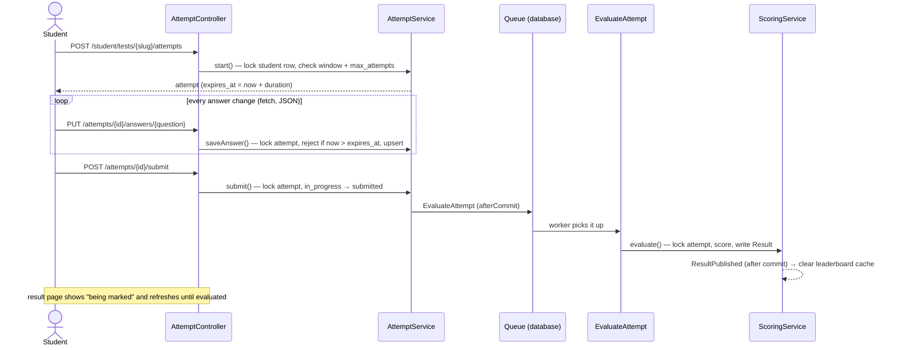
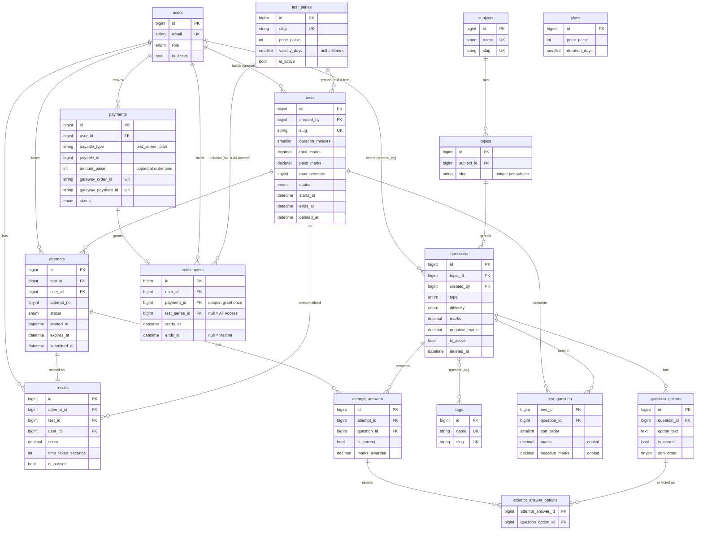

# TestForge — online exam & test-series platform

Teachers build question banks — with diagrams, image options and LaTeX maths — import them in bulk from
CSV, and generate tests from random picks. Students take timed tests with a server-enforced clock and
auto-save, get scored by a queued job, and see their rank, percentile and weakest subjects. Paid test series
(e.g. SSC, WBSC) and All-Access passes are sold through **Razorpay**.

Built with **Laravel 12** as a portfolio project. Every feature exists to show a common interview
topic: relationships, auth & policies, queues, events, caching, transactions with row locks,
indexing, window functions, and tests.

| Layer | Choice |
|---|---|
| Framework | Laravel 12, PHP 8.2+ |
| Database | MySQL 8.0+ or MariaDB 10.4+ (CTEs and window functions are required) |
| Web UI | Blade + Alpine.js + Tailwind (Laravel Breeze) |
| API | Laravel Sanctum personal access tokens, API Resources |
| Payments | Razorpay Standard Checkout (test mode), HMAC-verified callback + webhook |
| Maths | KaTeX (LaTeX + mhchem chemistry), loaded only on pages that need it |
| Queue, cache, sessions | `database` driver (works on shared hosting); Redis is a `.env` change |
| Tests | Pest — 223 tests on MySQL |

---

## Contents

- [Features](#features)
- [Quick start](#quick-start)
- [Demo logins](#demo-logins)
- [Architecture](#architecture)
- [Database (ER diagram)](#database)
- [Raw SQL vs Eloquent — the key queries](#raw-sql-vs-eloquent)
- [Concurrency: where the locks are](#concurrency)
- [REST API](#rest-api)
- [Bulk import (CSV + ZIP)](#bulk-import)
- [Payments (Razorpay)](#payments)
- [Tests](#tests)
- [Performance](#performance)
- [Deploying to cPanel shared hosting](#deploying-to-cpanel)

---

## Features

**Admin**
- Dashboard with counts (users by role, content, tests by status).
- Users: search and filter, change role, activate / deactivate (deactivation also revokes API tokens). An admin can't change their own role or status.
- Subjects and topics: full CRUD. Slugs are generated from names; a subject or topic that still has questions can't be deleted.
- Reports: every teacher's tests with averages, published tests nobody has attempted, and the full analytics of any test.
- **Paid test series** (price, validity or lifetime) and **All-Access passes**; a payments report with revenue; contact-form inbox.

**Teacher**
- Question bank: 2–6 options edited with Alpine, difficulty, marks, negative marks, explanation, tags. Filter by topic, difficulty and tag.
  - **Single vs multiple choice is derived from the answers**: one correct option → students pick one; two or more → students must select all correct answers (they aren't told how many).
  - **Diagrams**: an image on the question and/or on any option (an option can be image-only). JPG/PNG/WebP ≤ 2 MB, stored under random names.
  - **LaTeX maths**: `\( x^2 \)`, `$$ \frac{a}{b} $$`, chemistry `\( \ce{H2O} \)` — with a live preview while typing.
  - **Bulk import** from CSV (+ a ZIP of images), with a preview that lists every error before anything is saved.
  - The bank is shared (any teacher can view and use a question); only the author can edit or delete it.
  - Once a question is in a published test its **answer key is frozen** (type, options, correct answers).
- Test builder: details, time window, attempts allowed, shuffle, **series (or Free)**. Add questions from the bank, reorder them, remove them.
  - **Auto-select**: rules like "Algebra · hard · 4" + "Geometry · any · 6" pick random questions; then **swap** any one for another of the same topic and difficulty, remove, reorder, or edit it and come straight back. A composition summary shows the mix.
  - Publishing checks: at least one question, none inactive, pass mark ≤ total, end date not passed. A published test can only be archived.
- Analytics per test: average score, pass rate, top 10, **toughest 10 questions**, every result.
- Dashboard: own counts, latest results, published tests with no attempts yet.

**Student**
- Available tests with attempts used / left; start or resume. Paid tests show 🔒 **Unlock** until the series (or a pass) is bought.
- **Test series & passes** catalogue, Razorpay checkout, *My purchases*.
- Test screen: one question at a time, navigator, countdown, **auto-save on every answer**, submit with a summary of unanswered questions. When time runs out it submits itself.
- Result page: score, pass/fail, correct / wrong / skipped, accuracy, time, rank and percentile, every question with the correct answer and explanation.
- Leaderboard per test (best attempt per student), and *My analytics*: accuracy by subject, weakest first.

**Everyone**
- Public site: homepage with live numbers, Features, Contact, Terms, Privacy, Refunds; branded error pages.
- An animated **anvil-and-spark logo** (pure SVG + CSS, still for users who prefer reduced motion), sidebar layout for admins/teachers, distraction-free test screen.

**Behind the scenes**
- `EvaluateAttempt` queued job scores each submission (idempotent, retried 3×).
- `attempts:auto-submit` runs every minute and closes attempts whose time ran out.
- `ResultPublished` event → `ClearLeaderboardCache` listener.
- `imports:prune` (daily) deletes abandoned CSV uploads.

---

## Quick start

Requirements: PHP 8.2+ with `pdo_mysql`, Composer, Node 20+, MySQL 8 / MariaDB 10.4+.

```bash
git clone https://github.com/<you>/TestForge.git && cd TestForge
composer install
cp .env.example .env && php artisan key:generate

# databases: one for the app, one for the tests (phpunit.xml uses testforge_testing)
mysql -uroot -e "CREATE DATABASE testforge CHARACTER SET utf8mb4 COLLATE utf8mb4_unicode_ci;
                 CREATE DATABASE testforge_testing CHARACTER SET utf8mb4 COLLATE utf8mb4_unicode_ci;"
# set DB_USERNAME / DB_PASSWORD in .env if yours aren't root / empty

php artisan migrate --seed        # schema + demo data (~3 s)
php artisan storage:link          # serves uploaded question images from public/storage
npm install && npm run build

composer run dev                  # web server, queue worker, logs and Vite, together
php artisan schedule:work         # in a second terminal: runs attempts:auto-submit every minute
```

Open http://localhost:8000.

**Payments (optional):** create a free [Razorpay](https://razorpay.com) account → *Test Mode* → API keys, and put
them in `.env` (`RAZORPAY_KEY_ID=rzp_test_…`, `RAZORPAY_KEY_SECRET`, `RAZORPAY_WEBHOOK_SECRET`). Without keys,
everything works except the checkout, which says payments aren't set up yet. See [Payments](#payments).

**Bigger uploads:** PHP's default `upload_max_filesize` is often 2 MB. For image ZIPs in the bulk import, raise
`upload_max_filesize` and `post_max_size` (e.g. 25M) in `php.ini`.

The seed creates 1 admin, 3 teachers, 50 students, 5 subjects × 4 topics, 200 questions (+ hand-written
LaTeX and chemistry questions, and two diagram questions drawn with GD), 3 published tests, 90 scored attempts,
two paid series (**SSC** ₹299 lifetime ← Maths test, **WBSC** ₹499 / 365 days ← Science test; the CS Quiz stays
free) and two All-Access passes, so leaderboards, analytics and the shop have data straight away. Results are produced by
the real `ScoringService`, not random numbers, so every report agrees with every other.

---

## Demo logins

Password for every account: **`password`**

| Role | Email |
|---|---|
| Admin | `admin@testforge.test` |
| Teacher | `teacher1@testforge.test` (also `teacher2`, `teacher3`) |
| Student | `student1@testforge.test` — owns SSC and WBSC, has results in both; the free *Computer Science Quiz* is still open |
| Student | `student2@testforge.test` — brand new: nothing bought, no attempts. Use it to try the checkout. |

---

## Architecture

```
app/
  Enums/              UserRole, QuestionType, Difficulty, TestStatus, AttemptStatus (backed enums, cast on models)
  Services/           business logic — controllers stay thin
    QuestionService     save question + options + tags in one transaction; frozen answer key
    TestService         attach / reorder / publish / archive under a row lock
    AttemptService      start / save answer / submit / auto-submit under row locks
    ScoringService      scores an attempt (idempotent) and fires ResultPublished
    LeaderboardService  window-function ranking, cached 5 min
    AnalyticsService    subject accuracy, toughest questions, untouched tests, summaries
    QuestionImportService  CSV + ZIP bulk import: preview, then all-or-nothing import
    AccessService       who may start which test (series / All Access), granting access once
    PaymentService      Razorpay orders, idempotent markPaid()
    Payments/RazorpayGateway  the only class that talks to Razorpay (HTTP client, no SDK)
  Support/            QuestionRules (shared by form + importer), QuestionImages, Money, Access, ImportPreview
  Http/
    Controllers/Web/{Admin,Teacher,Student}   Blade app
    Controllers/Api/V1                        REST API
    Requests/                                 all validation lives in Form Requests
    Resources/                                API Resources (JSON shape)
    Middleware/EnsureRole.php                 route-level role check ('role:teacher')
  Policies/           record-level checks (QuestionPolicy, TestPolicy, AttemptPolicy, UserPolicy, PaymentPolicy)
  Jobs/EvaluateAttempt.php
  Events/ResultPublished.php  →  Listeners/ClearLeaderboardCache.php
  Console/Commands/AutoSubmitExpiredAttempts.php      (scheduled in routes/console.php)
  Exceptions/BusinessRuleException.php                (renders itself: flash on web, 422 on API)
resources/js/         Alpine components: question-form, image-picker, question-order, test-generator,
                      test-taker, razorpay-checkout; math.js (KaTeX, lazy-loaded)
docs/                 performance.md, TestForge.postman_collection.json
```

**Two layers of authorization.** `EnsureRole` answers *"may this user enter the teacher area?"*;
a Policy answers *"may this teacher edit **this** test?"* (owner, and still a draft). Policies are
attached declaratively — `->can('update', 'user')` on routes, or `HasMiddleware` on controllers.
There is no `Gate::before()` that lets admins do everything: admin rights are listed explicitly.

**Errors from business rules.** Services throw `BusinessRuleException` ("no attempts left",
"question is used in a test"). It renders itself — redirect back with a flash message on the web,
`422 {"message": …}` on the API — so controllers never need `try/catch`.

### Life of an attempt



---

## Database

18 application tables (InnoDB, `utf8mb4_unicode_ci`), plus Laravel's `sessions`, `cache`, `jobs`,
`failed_jobs` and Sanctum's `personal_access_tokens`. `questions` and `question_options` also have an
`image_path`; `contact_messages` (not drawn) stores the public contact form.



Design choices worth defending:

- **Marks are copied into `test_question`** when a question is attached, so editing a question later never changes an old test or result.
- **`results.test_id` / `user_id` are denormalised** (they're also reachable through `attempts`) so the leaderboard reads one table.
- **Multi-select answers use a child table (`attempt_answer_options`), not JSON**, so accuracy queries stay plain JOINs, protected by foreign keys.
- **Duplicates are stopped by the database, not just code:** `unique(test_id, user_id, attempt_no)`, `unique(attempt_id, question_id)` (the auto-save upsert key), `unique(results.attempt_id)`.
- **Enum values are hard-coded in migrations**, not read from the PHP enums, so a migration never changes after it has run.
- `(status, expires_at)` index for the auto-submit command; covering indexes added after EXPLAIN — see [Performance](#performance).
- **Money is integer paise**, never a float, and the **price is copied onto the payment** when the order is created — like the pivot marks, a later price change never touches an existing order.
- **`unique(entitlements.payment_id)`**: a payment can grant access exactly once, even when the browser callback and the webhook both arrive.

---

## Raw SQL vs Eloquent

The four key queries are written as raw SQL in `LeaderboardService` and `AnalyticsService`, each with its
Query Builder / Eloquent version in a comment next to it. Raw SQL is used where the query **is** the point
(window functions, CTEs, a careful GROUP BY) and you want to read it, EXPLAIN it, and paste it into a SQL
console unchanged. Eloquent is used everywhere else, because relationships, scopes, eager loading and casts
make normal CRUD shorter and safer. Every raw query uses `?` bindings — never string-concatenated input.

### 1. Leaderboard — rank and percentile by each student's best attempt

```sql
WITH best AS (                              -- each student's attempts, best first
    SELECT r.user_id, r.score, r.time_taken_seconds,
           ROW_NUMBER() OVER (PARTITION BY r.user_id
                              ORDER BY r.score DESC, r.time_taken_seconds ASC, r.id ASC) AS rn
    FROM results r
    WHERE r.test_id = ?
),
ranked AS (                                 -- rank the best attempts against each other
    SELECT b.user_id, b.score, b.time_taken_seconds,
           RANK()         OVER (ORDER BY b.score DESC, b.time_taken_seconds ASC) AS rank_no,
           PERCENT_RANK() OVER (ORDER BY b.score ASC,  b.time_taken_seconds DESC) AS percent_rank,
           COUNT(*)       OVER () AS total_students
    FROM best b
    WHERE b.rn = 1
)
SELECT ranked.rank_no, ranked.user_id, u.name, ranked.score, ranked.time_taken_seconds,
       ROUND(ranked.percent_rank * 100, 2) AS percentile, ranked.total_students
FROM ranked JOIN users u ON u.id = ranked.user_id
ORDER BY ranked.rank_no, u.name
LIMIT 50;
```

- A window function can't be filtered in the `WHERE` of its own `SELECT`, hence the CTE: compute `rn`, then keep `rn = 1`.
- `RANK()` gives ties the same rank and skips (1, 1, 3). `PERCENT_RANK()` = (rank − 1) / (n − 1) in ascending order = the share of students you beat.
- `COUNT(*) OVER ()` gives the number of students *before* the `LIMIT`.
- Cached for 5 minutes per test (`leaderboard:test:{id}`); a student's own rank (`rankOf`) uses the same SQL with `WHERE ranked.user_id = ?` in the outer query, so it works outside the top 50.

```php
$best = DB::table('results')
    ->select('user_id', 'score', 'time_taken_seconds')
    ->selectRaw('ROW_NUMBER() OVER (PARTITION BY user_id ORDER BY score DESC, time_taken_seconds, id) AS rn')
    ->where('test_id', $testId);

$ranked = DB::query()->fromSub($best, 'b')->where('b.rn', 1)
    ->select('b.user_id', 'b.score', 'b.time_taken_seconds')
    ->selectRaw('RANK() OVER (ORDER BY b.score DESC, b.time_taken_seconds) AS rank_no')
    ->selectRaw('PERCENT_RANK() OVER (ORDER BY b.score, b.time_taken_seconds DESC) AS percent_rank')
    ->selectRaw('COUNT(*) OVER () AS total_students');

DB::query()->fromSub($ranked, 'ranked')
    ->join('users as u', 'u.id', '=', 'ranked.user_id')
    ->select('ranked.*', 'u.name')
    ->orderBy('rank_no')->orderBy('u.name')->limit(50)->get();
```

### 2. Subject-wise accuracy for a student (weakest first)

```sql
SELECT s.id AS subject_id, s.name AS subject,
       COUNT(*) AS attempted,
       SUM(aa.is_correct) AS correct,
       ROUND(AVG(aa.is_correct) * 100, 2) AS accuracy
FROM attempt_answers aa
JOIN attempts  a ON a.id = aa.attempt_id
JOIN questions q ON q.id = aa.question_id
JOIN topics    t ON t.id = q.topic_id
JOIN subjects  s ON s.id = t.subject_id
WHERE a.user_id = ? AND aa.is_correct IS NOT NULL
GROUP BY s.id, s.name
ORDER BY accuracy ASC, attempted DESC;
```

`AVG(is_correct)` works because a boolean is stored as 0/1. `is_correct IS NOT NULL` keeps answers that
are still waiting in the queue out of the numbers.

```php
DB::table('attempt_answers as aa')
    ->join('attempts as a', 'a.id', '=', 'aa.attempt_id')
    ->join('questions as q', 'q.id', '=', 'aa.question_id')
    ->join('topics as t', 't.id', '=', 'q.topic_id')
    ->join('subjects as s', 's.id', '=', 't.subject_id')
    ->where('a.user_id', $userId)->whereNotNull('aa.is_correct')
    ->groupBy('s.id', 's.name')
    ->select('s.id as subject_id', 's.name as subject')
    ->selectRaw('COUNT(*) AS attempted, SUM(aa.is_correct) AS correct')
    ->selectRaw('ROUND(AVG(aa.is_correct) * 100, 2) AS accuracy')
    ->orderBy('accuracy')->get();
```

### 3. Toughest questions in a test

```sql
SELECT q.id AS question_id, q.body, q.difficulty, s.answered, s.correct_pct
FROM (
    SELECT aa.question_id,
           COUNT(*) AS answered,
           ROUND(AVG(aa.is_correct) * 100, 2) AS correct_pct
    FROM attempt_answers aa
    JOIN attempts a ON a.id = aa.attempt_id
    WHERE a.test_id = ? AND aa.is_correct IS NOT NULL
    GROUP BY aa.question_id
    HAVING COUNT(*) >= 10                -- HAVING, not WHERE: it filters on an aggregate
) s
JOIN questions q ON q.id = s.question_id
ORDER BY s.correct_pct ASC, s.answered DESC
LIMIT 10;
```

*Aggregate first, join later:* the first version grouped by `q.id, q.body, q.difficulty`; `body` is a TEXT
column, so MySQL grouped ~268k rows on disk (1.6 s). Grouping by the integer id first takes 166 ms with
the covering index ([details](docs/performance.md)).

```php
$stats = DB::table('attempt_answers as aa')
    ->join('attempts as a', 'a.id', '=', 'aa.attempt_id')
    ->where('a.test_id', $testId)->whereNotNull('aa.is_correct')
    ->groupBy('aa.question_id')
    ->select('aa.question_id')
    ->selectRaw('COUNT(*) AS answered, ROUND(AVG(aa.is_correct) * 100, 2) AS correct_pct')
    ->havingRaw('COUNT(*) >= ?', [10]);

DB::query()->fromSub($stats, 's')
    ->join('questions as q', 'q.id', '=', 's.question_id')
    ->select('q.id as question_id', 'q.body', 'q.difficulty', 's.answered', 's.correct_pct')
    ->orderBy('s.correct_pct')->orderByDesc('s.answered')->limit(10)->get();
```

### 4. Published tests with no attempts

```sql
SELECT t.id, t.title, t.slug, t.published_at, u.name AS teacher
FROM tests t
JOIN users u ON u.id = t.created_by
LEFT JOIN attempts a ON a.test_id = t.id
WHERE t.status = 'published' AND t.deleted_at IS NULL
  AND a.id IS NULL                       -- no matching attempt row
ORDER BY t.published_at DESC;
```

The `LEFT JOIN` keeps every test; tests without attempts get `NULL` attempt columns, and `a.id IS NULL`
keeps exactly those (an anti-join — EXPLAIN shows `Not exists`).

```php
// Query Builder
DB::table('tests as t')
    ->join('users as u', 'u.id', '=', 't.created_by')
    ->leftJoin('attempts as a', 'a.test_id', '=', 't.id')
    ->where('t.status', 'published')->whereNull('t.deleted_at')->whereNull('a.id')
    ->select('t.id', 't.title', 't.slug', 't.published_at', 'u.name as teacher')
    ->orderByDesc('t.published_at')->get();

// Eloquent (NOT EXISTS sub-query)
Test::published()->doesntHave('attempts')->get();
```

---

## Concurrency

Everywhere a double click or two tabs could cause a problem, the code runs in `DB::transaction()`, takes a
row lock with `lockForUpdate()` (`SELECT … FOR UPDATE`), and **re-checks the rule under the lock**
(a policy check that ran a moment earlier may no longer be true).

| Action | Locked row | Why that row |
|---|---|---|
| Start an attempt | the **student's** `users` row | two "Start" clicks queue behind each other, while different students never wait for one another (locking the test would serialise everyone starting it) |
| Save an answer | the attempt | status and `expires_at` checked under the lock; then `upsert` on `unique(attempt_id, question_id)` |
| Submit | the attempt | `in_progress → submitted` happens exactly once, so exactly one scoring job is queued |
| Score (job) | the attempt | already `evaluated` → returns the existing result; `unique(results.attempt_id)` as a last guard |
| Attach / reorder / publish / archive | the test | "attach in one tab" and "publish in another" can't interleave |
| Auto-submit command | each attempt | a student who submits a second before the command reaches them is left alone |
| Generate / swap questions | the test | random picks always see the test's current questions |
| Mark a payment paid | the payment | browser callback + webhook + Razorpay retries → granted once |
| Grant access | the student's `users` row | two purchases finishing together can't compute the same start date when stacking |

The scoring job is queued with `afterCommit()` and `ResultPublished` implements `ShouldDispatchAfterCommit`,
so nothing outside the transaction ever sees work that might still roll back.

---

## REST API

Base URL `/api/v1`. Auth: Sanctum personal access tokens — send `Authorization: Bearer <token>`.
Errors are **always JSON**, even without an `Accept` header.

| Method | Endpoint | Who | Response |
|---|---|---|---|
| POST | `/auth/register` | public | **201** `{ token, token_type, user }` — always a student |
| POST | `/auth/login` | public | **200** `{ token, … }` · 422 wrong credentials · 403 deactivated |
| POST | `/auth/logout` | any | **204** — revokes the current token only |
| GET | `/me` | any | the current user |
| GET | `/tests` | student | available tests with attempts left (paginated) |
| GET | `/tests/{test}/leaderboard` | any | top 50 + `me` (your own rank) · 404 for drafts |
| GET | `/me/results` | student | your results, newest first (paginated) |
| GET | `/me/analytics` | student | subject accuracy (weakest first) + summary |

401 = no or invalid token, 403 = wrong role, 422 = validation or business rule. Login and register are
limited to 6 requests a minute; everything else to 60 per user per minute.

```bash
TOKEN=$(curl -s -X POST http://localhost:8000/api/v1/auth/login \
  -d email=student1@testforge.test -d password=password | jq -r .token)
curl -s -H "Authorization: Bearer $TOKEN" http://localhost:8000/api/v1/tests/1/leaderboard | jq
```

A Postman collection is in [`docs/TestForge.postman_collection.json`](docs/TestForge.postman_collection.json)
— its Login request stores the token for all the others.

---

## Bulk import

*Question bank → Import CSV* → upload a CSV (and optionally a ZIP of images) → a **preview** lists every row as OK
or with its errors (row-numbered) → **Import** is only enabled when there are no errors. All-or-nothing, so a
corrected re-upload never creates duplicates; the confirm step re-reads and re-validates the file instead of
trusting the preview.

```
subject,topic,difficulty,marks,negative_marks,body,explanation,tags,image,
option_1,option_1_image, … ,option_6,option_6_image,correct
```

- `subject`, `topic` by name (must exist); `correct` = `2` or `1|3` (one → single choice, several → multiple);
  `tags` separated by `|`; `image` / `option_N_image` = file names inside the ZIP. A template is downloadable.
- Every row is validated with **the same rules as the form** (`App\Support\QuestionRules`).
- Images are checked inside the ZIP **without extracting** (size, real type from the bytes, ≤ 4000 px) and copied out
  by content only — paths inside the ZIP are never used, so a crafted `../../evil.php` entry can't write anywhere.
- Limits: 500 rows, CSV ≤ 2 MB, ZIP ≤ 20 MB (raise PHP's upload limits for big ZIPs). UTF-8 with or without BOM.

---

## Payments

Paid **test series** (one series, for N days or lifetime) and **All-Access passes** (every test for N days), sold
with [Razorpay Standard Checkout](https://razorpay.com/docs/payments/payment-gateway/web-integration/standard/).
Tests with no series are free. Access is checked when an attempt **starts**; an attempt already in progress can
always be finished.

```mermaid
sequenceDiagram
    actor S as Student
    participant C as CheckoutController
    participant P as PaymentService
    participant R as Razorpay
    participant W as Webhook

    S->>C: POST /student/checkout {type, id}  (no price!)
    C->>P: createOrder() — payments row, amount FROM THE DB
    P->>R: POST /v1/orders (after commit — no network call inside a transaction)
    R-->>P: order_id
    S->>R: pays in the Checkout.js popup (test cards / UPI in test mode)
    R-->>S: payment_id + order_id + signature
    S->>C: POST /student/checkout/verify
    C->>C: HMAC-SHA256(order_id|payment_id, key_secret) == signature?
    C->>P: markPaid() — lock payment row; already paid → no-op
    P->>P: AccessService::grant() — entitlement (unique payment_id)
    R->>W: payment.captured (also when the tab was closed)
    W->>W: HMAC of the RAW body with the webhook secret
    W->>P: markPaid() — same idempotent path; amount must match
```

**Set-up (test mode, no KYC):** Razorpay dashboard → *Test Mode* → *API Keys* → `RAZORPAY_KEY_ID` / `RAZORPAY_KEY_SECRET`;
*Webhooks* → URL `https://your-domain/api/webhooks/razorpay`, events `payment.captured`, `order.paid`, `payment.failed`,
and a secret → `RAZORPAY_WEBHOOK_SECRET`. Pay with the test cards / UPI IDs from Razorpay's test-mode docs.
Locally Razorpay can't reach `localhost`, so the browser callback does the work — use a tunnel (ngrok, cloudflared)
to try the webhook.

Why it is safe:
- The browser only says *what* to buy; the **amount comes from the database** and is fixed in the Razorpay order.
- A payment counts only with a valid **HMAC signature** (`hash_equals`, constant-time); the secret never reaches the page.
- `markPaid()` locks the payment row and returns early if it's already paid; `unique(entitlements.payment_id)` backs it up.
- The webhook rejects bad signatures (400), ignores amounts that don't match, and never turns a paid order into a failed one.
- `payments.payable_type` stores `test_series` / `plan` (`Relation::enforceMorphMap`), not PHP class names.

Out of scope: refunds (done from the Razorpay dashboard), GST invoices, coupons, auto-renewing subscriptions.

---

## Tests

```bash
php artisan test        # 223 tests, ~40 s, against the testforge_testing MySQL database
```

Tests run on MySQL (not SQLite) because the code relies on MySQL behaviour: window functions, enums,
`lockForUpdate()`. Each test runs inside a rolled-back transaction (`RefreshDatabase`).

| File | Covers |
|---|---|
| `Unit/ScoringRuleTest` | the scoring rule alone: single, exact set, partial / extra options, normalisation |
| `Feature/AuthTest` | login redirect per role, the role × area access matrix, deactivated users, no role injection at registration |
| `Feature/AttemptFlowTest` | start, resume, max attempts, closed tests, upsert, invalid answers, **expired save rejected**, **double submit**, auto-submit command, no answer key in the page |
| `Feature/ScoringTest` | single, multiple (exact / partial / superset), **negative marks**, skipped, pivot marks vs edited question, idempotent scoring |
| `Feature/LeaderboardTest` | **order** (score, then time), best attempt per student, `RANK` ties, percentile, top 50 vs `rankOf`, cache invalidation |
| `Feature/ApiTest` | tokens, 201/204/401/403/404/422, JSON errors without `Accept`, pagination shape |
| `Feature/TestBuilderTest` | publish rules, frozen answer key, ownership, question-in-use |
| `Feature/QueryCountTest` | N+1 guard: query budgets per page, and counts that don't grow with the data (incl. a polymorphic list) |
| `Feature/QuestionImageTest` | uploads, replace/remove, SVG/size/dimension rejection, random names, cleanup when a save fails, locked option images |
| `Feature/QuestionTypeTest` | single/multiple derived from the correct answers; a posted `type` is ignored |
| `Feature/MathTextTest` | LaTeX reaches every page unchanged and HTML-escaped |
| `Feature/QuestionImportTest` | template, preview errors per row, BOM, ZIP images, all-or-nothing, re-validation on confirm, privacy, pruning |
| `Feature/TestGeneratorTest` | rule picking, no duplicates, specific-rules-first, rollback on shortfall, swap, edit-and-return (no open redirect) |
| `Feature/AccessTest` | free vs paid tests, series vs All Access, expiry, stacking, lifetime, API `is_locked`, admin pricing in paise |
| `Feature/PaymentTest` | Razorpay (faked): DB price, signatures, idempotency (callback + webhook), amount mismatch, outage, passes |
| `Feature/PublicPagesTest`, `ContactTest` | public pages + legal links, live homepage numbers, honeypot, rate limit, admin inbox, error pages |
| `Feature/Auth/*` | Breeze's own auth tests |

---

## Performance

See [docs/performance.md](docs/performance.md). In short:

- **N+1:** `Model::preventLazyLoading()` outside production, plus a test that fails if any list page goes over its query budget or its query count grows with the rows.
- **EXPLAIN at realistic size** (20k students, 535k answers): the toughest-questions query went from **1,629 ms to 166 ms** (rewrite + covering index); the leaderboard became index-only; "my results" lost its filesort.

---

## Deploying to cPanel

Shared hosting has no Redis, no Supervisor and usually no Node, so the app is built to run with **one cron entry**.

1. **Build assets on your machine** — `npm ci && npm run build` — and upload `public/build/` with the code
   (it's git-ignored, so either upload it separately or build in a deploy step).
2. **Upload / clone** the project *outside* `public_html`, then point the domain's document root at the project's
   `public/` folder (or symlink `public_html` → `public`).
3. **PHP 8.2+** in *MultiPHP Manager*; extensions `pdo_mysql`, `mbstring`, `openssl`, `tokenizer`, `xml`, `ctype`,
   `fileinfo`, `gd`, `zip`. In *MultiPHP INI Editor* raise `upload_max_filesize` / `post_max_size` (e.g. 25M) for image ZIPs.
4. Create the MySQL database and user in cPanel, then `.env`:

   ```dotenv
   APP_ENV=production
   APP_DEBUG=false
   APP_URL=https://exams.example.com
   APP_TIMEZONE=Asia/Dhaka          # whatever your users' local time is

   DB_CONNECTION=mysql
   DB_DATABASE=cpaneluser_testforge
   DB_USERNAME=cpaneluser_tf
   DB_PASSWORD=...

   QUEUE_CONNECTION=database        # jobs live in the `jobs` table
   CACHE_STORE=database
   SESSION_DRIVER=database
   QUEUE_RUN_VIA_SCHEDULER=true     # see step 6

   RAZORPAY_KEY_ID=rzp_live_...     # rzp_test_... until you go live
   RAZORPAY_KEY_SECRET=...
   RAZORPAY_WEBHOOK_SECRET=...      # webhook URL: https://exams.example.com/api/webhooks/razorpay
   ```

5. Over SSH (or *Terminal* in cPanel):

   ```bash
   composer install --no-dev --optimize-autoloader
   php artisan key:generate
   php artisan migrate --force
   php artisan db:seed --force      # only if you want the demo data
   php artisan storage:link         # question images
   php artisan config:cache && php artisan route:cache && php artisan view:cache
   ```

   If the host blocks `symlink()`, point the `public` disk at the web root instead: in `config/filesystems.php`
   set its `root` to `public_path('storage')`.

   `storage/` and `bootstrap/cache/` must be writable by PHP.
6. **One cron job** (*cPanel → Cron Jobs*, every minute):

   ```
   * * * * * cd /home/cpaneluser/testforge && php artisan schedule:run >> /dev/null 2>&1
   ```

   The scheduler then runs `attempts:auto-submit` **and**, because `QUEUE_RUN_VIA_SCHEDULER=true`,
   `queue:work --stop-when-empty --max-time=55`: a worker that drains the `jobs` table and exits before the
   next minute (`withoutOverlapping()` stops runs piling up). Results therefore appear within about a minute
   of submitting — the result page shows "being marked" and refreshes itself until then.
7. Failed jobs land in `failed_jobs`; re-run them with `php artisan queue:retry all`.
8. Before taking real payments, review the **Terms, Privacy and Refund** pages (template text, marked as such) —
   Razorpay checks that they exist and are linked from every page.

On a VPS, use Supervisor to keep `php artisan queue:work` running instead, set `QUEUE_RUN_VIA_SCHEDULER=false`,
and optionally switch `QUEUE_CONNECTION` / `CACHE_STORE` to `redis`.
